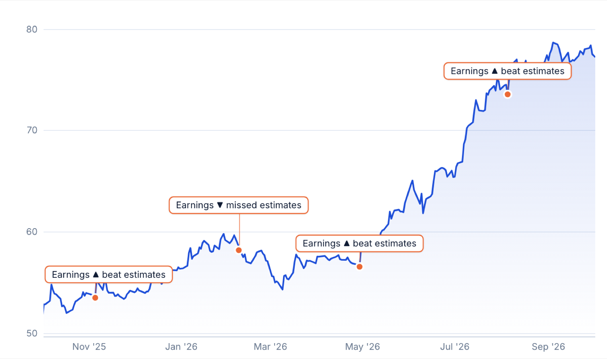

<div align="center">

# 📈 Singapore STI

An interactive chart of the Straits Times Index and all 30 of its constituents,<br>
marked with the crises, policy changes and earnings results that moved them.

<br>

[](https://fang89.github.io/Singapore-STI/)

**👉 [fang89.github.io/Singapore-STI/](https://fang89.github.io/Singapore-STI/)**

<br>


<br>

<a href="https://fang89.github.io/Singapore-STI/"><picture><source media="(prefers-color-scheme: dark)" srcset="docs/screenshots/sti-chart-dark.png"></picture></a>

</div>

---

Daily closes go back to **December 1987** for the index (2000s onward for most
constituents). On top of the prices sit 46 curated market events (crises, Singapore
stories, policy shifts and index milestones) and every earnings release Yahoo records
for each constituent, marked as a beat or a miss against consensus EPS.

It started as a section of [SG Finance](https://fang89.github.io/Singapore-personal-finance/),
the Singapore household money guide, and now lives here on its own.

## Features

- Canvas line chart with crosshair tooltip, wheel-zoom, drag-pan and an
  overview brush strip
- Event annotations on the chart: callout boxes with leader lines when zoomed
  in, dots on the price line when zoomed out. Cards below list what's in view, and
  clicking one zooms to ±18 months around it
- Ticker switcher for the index and its 30 constituents, grouped by sector, showing
  each ticker's return over the window on screen
- Range presets (1W / 1M / 3M / 1Y / 5Y / Max, opening on 1M), linear or log scale, and event-category filters (including earnings)
- Compare against the S&P 500, Nasdaq, Hang Seng, Nikkei, Bitcoin or gold
- **200-day average** on any ticker, with the days spent below it shaded, and what returns and
  volatility looked like on each side of it
- **Market mood**, a 0–100 fear-to-greed reading for the STI built from five price-based
  measures (trend, breadth, new highs vs lows, drawdown and volatility), drawn under the chart
  and broken down in a panel with what the STI did next from each mood band. How it is built,
  the research behind it and how it tested on 38 years of STI history are in
  [METHODOLOGY.md](METHODOLOGY.md)
- Light and dark themes (follows the system, with a manual toggle), and a yearly data table

## Files

| File | Purpose |
|---|---|
| `index.html` | The page: markup, styles and the theme toggle |
| `app.js` | Chart, controls and event code |
| `indicators.js` | 200-day average and market mood calculations (no drawing) |
| `data.js` | Price history (`window.STI_DATA`), generated by the fetch script |
| `benchmarks.js` | Comparison benchmarks (`window.STI_BENCH`) |
| `earnings.js` | Earnings dates and EPS vs consensus per constituent |
| `logos.js` | Company favicons embedded as data URIs |
| `profiles.js` | One-line company blurbs and live market caps |
| `fetch_data.py` | Refreshes `data.js` from Yahoo Finance (`pip install yfinance`) |
| `fetch_benchmarks.py` | Refreshes `benchmarks.js` (S&P 500, Nasdaq, Hang Seng, Nikkei, Bitcoin, gold) |
| `fetch_earnings.py` | Refreshes `earnings.js` |
| `fetch_logos.py` | Refreshes `logos.js` |
| `fetch_profiles.py` | Refreshes `profiles.js` (market caps; blurbs curated inside it) |
| `tools/backtest.py` | Tests the indicators on STI history and prints every table in METHODOLOGY.md (`pip install pandas numpy`) |
| `METHODOLOGY.md` | How the trend and mood indicators work, and how far to trust them |

No build step and no dependencies. To run it locally:

```bash
python3 -m http.server   # then open http://localhost:8000
```

## Updating the data

Run these from the repo root:

```bash
python3 fetch_data.py       # prices
python3 fetch_benchmarks.py # comparison benchmarks
python3 fetch_earnings.py   # earnings history
python3 fetch_logos.py      # logos (rarely needed)
python3 fetch_profiles.py   # market caps
```

Events are curated by hand in the `EVENTS` array at the top of `app.js`.

## Notes

- Prices are unadjusted daily closes from Yahoo Finance. Long-history series
  reflect Yahoo's records, including any splits or re-listings as Yahoo reports them.
- Earnings history depth varies by ticker. A few tickers (Hongkong Land,
  CapitaLand Investment, MPACT, FCT) have none in Yahoo's records.
- Not investment advice.

## Licence

MIT
